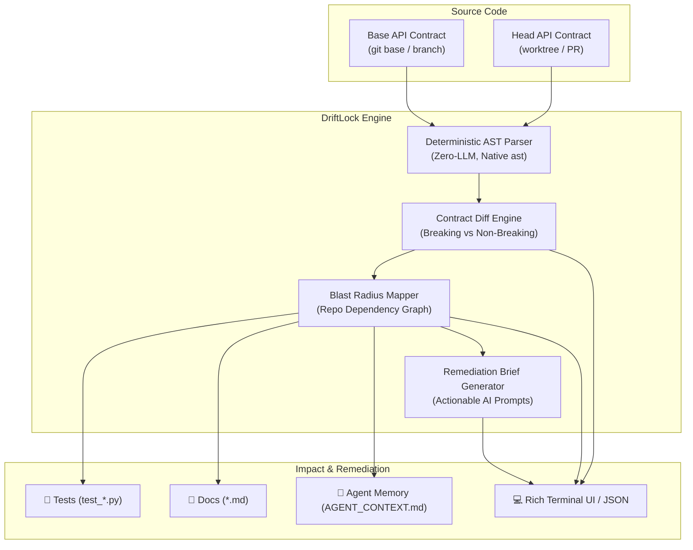

# DriftLock 🔒

**Autonomous AST Drift and Contract Consistency Engine**  
*Deterministically synchronizing API contracts, tests, documentation, and AI agent memory.*

[](https://www.python.org/)
[](tests/)
[](#core-engine)
[](#supported-frameworks)
[](LICENSE)

---

## ⚡ The Problem

Modern software development moves at breakneck speed. When human developers or AI coding agents update API schemas or endpoints—such as adding a required field to a Pydantic model or modifying a route signature—silent contract drift occurs:

1. **🧪 Tests Silently Rot**: Test fixtures and assertions omit newly required fields, leading to runtime failures or false positives.
2. **📖 Documentation Desynchronizes**: Markdown specs, READMEs, and API references describe outdated schemas.
3. **🤖 AI Agent Hallucinations**: Agent memory files (`AGENT_CONTEXT.md`, system prompts, instructions) preserve stale contract assumptions. The agent continues generating code for outdated schemas, causing cascading bugs.
4. **💥 Unsafe Runtime Introspection**: Traditional tools import or execute target modules, triggering environment variable crashes, database connection failures, and missing dependency errors.

---

## 🎯 The Solution: DriftLock

**DriftLock** provides a zero-execution, deterministic consistency engine that guarantees your codebase and AI agent memory stay aligned with your API contracts:

- **Deterministic Zero-LLM Parser**: Analyzes Python code using the native `ast` module. Never imports or executes code—completely side-effect free, instant, and secure.
- **Contract Diffing Engine**: Compares base and head contracts, classifying changes into breaking vs. non-breaking drifts (`FIELD_ADDED`, `FIELD_REMOVED`, `FIELD_TYPE_CHANGED`, `ROUTE_ADDED`, `ROUTE_REMOVED`).
- **Blast Radius Mapper**: Traverses the repository to detect impacted files across **Tests**, **Documentation**, and **Agent Memory** (`AGENT_CONTEXT.md`).
- **Remediation Brief Synthesis**: Automatically generates structured action briefs with precise instructions for AI agents (e.g. Alan AI, Claude, Qwen) or developers to repair stale references.
- **Interactive Rich Visualizer**: Renders beautiful terminal trees, tables, and CI-ready JSON outputs.

---

## 🏗 Architecture Overview



---

## 🚀 Quickstart

### 1. Prerequisites
- Python 3.11+
- Git

### 2. Installation

```bash
# Clone repository
git clone https://github.com/Jishnu1618/Driftlock.git
cd Driftlock

# Set up virtual environment
python -m venv .venv

# On Linux / macOS:
source .venv/bin/activate

# On Windows (PowerShell):
.\.venv\Scripts\Activate.ps1

# Install dependencies
pip install -r requirements.txt
```

### 3. Run the Test Suite

```bash
pytest tests/ -v
```

All 27 deterministic unit and integration tests will execute in ~1 second.

---

## 💻 CLI Usage

DriftLock provides a Typer-powered CLI with Rich terminal formatting and machine-readable JSON exports.

### Run End-to-End Demo

Experience DriftLock's full audit lifecycle on the included demonstration fixtures:

```bash
python -m driftlock.cli.main demo
```

To output the raw structured JSON payload (ideal for CI/CD pipelines):

```bash
python -m driftlock.cli.main demo --json
```

### Audit Real API Contracts

Audit two versions of an API contract against a target repository:

```bash
python -m driftlock.cli.main audit path/to/base_api.py path/to/head_api.py --repo .
```

Options:
- `--repo PATH`: Root directory to scan for blast radius dependencies (default: `.`)
- `--json`: Output report as formatted JSON instead of terminal tables and trees

---

## 📋 Sample Demo Walkthrough

In `fixtures/demo_repo/`:
- **Base Contract** (`api_base.py`):
  ```python
  class UserCreate(BaseModel):
      username: str
      email: str
  ```
- **Head Contract** (`api_head.py`):
  ```python
  class UserCreate(BaseModel):
      username: str
      email: str
      tier: str                  # BREAKING: Required field added
      organization_id: int = 1   # NON-BREAKING: Optional field with default
  ```

### CLI Terminal Output

```
DriftLock: AST Contract Drift & Blast Radius Audit
================================================================================
Base Contract: fixtures/demo_repo/api_base.py
Head Contract: fixtures/demo_repo/api_head.py
Repository:    fixtures/demo_repo
================================================================================

Contract Drift Summary (4 changes detected)
--------------------------------------------------------------------------------
Category     Identifier               Breaking?   Details
--------------------------------------------------------------------------------
FIELD_ADDED  UserCreate.tier          BREAKING    Field 'tier' added (type=str, required=True)
FIELD_ADDED  UserCreate.org_id        SAFE        Field 'organization_id' added (type=int, default=1)
FIELD_ADDED  UserResponse.tier        BREAKING    Field 'tier' added (type=str, required=True)
FIELD_ADDED  UserResponse.org_id      BREAKING    Field 'organization_id' added (type=int, required=True)
--------------------------------------------------------------------------------

Blast Radius Dependency Tree (10 stale references found)
-- TEST (2 hits)
   └── fixtures/demo_repo/tests/test_users.py
       ├── Test references 'UserCreate' but is missing newly added field 'organization_id'
       └── -> Update test fixtures and assertions to include 'organization_id'
-- DOCUMENTATION (4 hits)
   └── fixtures/demo_repo/README.md
       ├── Documentation references 'UserCreate' but is missing newly added field 'tier'
       └── -> Add documentation for the new field 'tier' on 'UserCreate'
-- AGENT MEMORY (4 hits)
   └── fixtures/demo_repo/AGENT_CONTEXT.md
       ├── Agent context references 'UserCreate' but is missing newly added field 'tier'
       └── -> Update agent context to include the new field 'tier' in 'UserCreate' definition
```

---

## 🔍 Supported Frameworks & AST Capabilities

DriftLock operates without code execution, parsing abstract syntax trees via Python's `ast` module:

| Framework / Feature | Supported Patterns | Extracted Metadata |
| :--- | :--- | :--- |
| **FastAPI** | `@app.get`, `@app.post`, `@router.put`, `@router.delete` | URL path, HTTP verb, status code, response model, path parameters, query params, `Depends`, `Header`, request body |
| **Flask / Starlette** | `@app.route(...)`, `@bp.route(...)` | Endpoint path, allowed methods, view function docstrings |
| **Pydantic v1 & v2** | `class Model(BaseModel):` | Field names, type annotations, defaults, required vs. optional status |
| **Pydantic Constraints** | `Field(..., ge=0, min_length=3)` | Numeric bounds (`ge`, `gt`, `le`, `lt`), string lengths, regex patterns |
| **Annotated Metadata** | `Annotated[str, Field(min_length=1)]` | Unpacks nested typing wrappers and extracts inner metadata |
| **Stacked Decorators** | Multiple route decorators on a single function | Discovers all distinct URL endpoints and verbs |
| **Docstrings** | Function docstrings & PEP 257 attribute docstrings | Contextual documentation associated with models and endpoints |

---

## 📂 Project Structure

```
Driftlock/
├── driftlock/
│   ├── core/
│   │   ├── models.py           # Pydantic contract definitions (Routes, Schemas, Fields)
│   │   ├── parser.py           # Native AST parser (Zero-LLM static extractor)
│   │   └── diff.py             # Contract diffing engine (Breaking vs. Safe classification)
│   ├── blast_radius/
│   │   └── graph.py            # Blast radius mapper (Tests, Docs, Agent Memory)
│   └── cli/
│       └── main.py             # Typer + Rich terminal UI & JSON export
├── fixtures/
│   └── demo_repo/              # Complete drift scenario fixtures
│       ├── api_base.py         # Original contract
│       ├── api_head.py         # Modified contract (drifted)
│       ├── AGENT_CONTEXT.md    # Stale AI agent context
│       ├── README.md           # Stale documentation
│       └── tests/
│           └── test_users.py   # Stale unit test
├── tests/
│   ├── test_parser.py          # 8 parser unit tests
│   └── test_diff_and_blast.py  # 19 diff, blast radius, and CLI integration tests
├── DRIFTLOCK_STATE.md          # Architecture log & phase tracker
├── dev_phases.md               # Phase roadmap specification
├── pyproject.toml              # Project configuration & pytest settings
├── requirements.txt            # Project dependencies
└── README.md                   # Project documentation
```

---

## 🗺 Roadmap & Phase Progression

| Phase | Milestone | Deliverables | Status |
| :---: | :--- | :--- | :---: |
| **1** | **AST Contract Parser** | Deterministic route & schema extraction with zero-LLM overhead | 🟢 Complete |
| **2** | **Blast Radius Graph** | Map AST diffs to impacted tests, docs, and `AGENT_CONTEXT.md` | 🟢 Complete |
| **3** | **Remediation Brief** | Synthesize actionable repair instructions for AI agents | 🟢 Complete |
| **4** | **Terminal Visualizer & CLI** | Rich tree & table UI with JSON output for CI/CD | 🟢 Complete |
| **5** | **Git Ops & Automated PR** | Automatic patch application, branch creation, and GitHub PR | ⚪ Planned |
| **6** | **Demo Video & Packaging** | End-to-end screen recording & PyPI distribution | 🟡 In Progress |

---

## 🤝 Contributing

Contributions are welcome! Please open an issue or submit a pull request:

1. Fork the repository
2. Create your feature branch (`git checkout -b feature/amazing-feature`)
3. Ensure all tests pass (`pytest tests/ -v`)
4. Commit your changes (`git commit -m 'feat: add amazing feature'`)
5. Push to the branch (`git push origin feature/amazing-feature`)
6. Open a Pull Request

---

## 📄 License

This project is licensed under the MIT License - see the [LICENSE](LICENSE) file for details.
