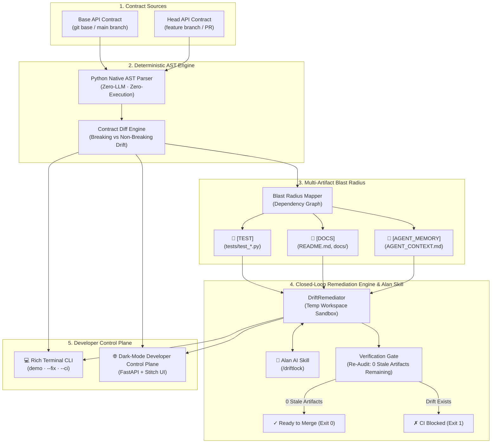

# DriftLock 🔒

**Deterministic Contract & Context Consistency Layer for AI-Assisted Development**  
*Guaranteed synchronization between API contracts, tests, documentation, and AI agent memory.*

[](https://driftlock-xicn.onrender.com/)
[](https://github.com/Jishnu1618/Driftlock/actions/workflows/driftlock-ci.yml)
[](tests/)
[](https://www.python.org/)
[](.alan/skills/driftlock.md)

---

> ### 🌐 Live Production Control Plane
> **Dashboard URL:** [**https://driftlock-xicn.onrender.com/**](https://driftlock-xicn.onrender.com/)  
> *Experience the dark-mode developer control plane, interactive blast radius dependency tree, and 1-click closed-loop contract remediation live in your browser.*

---

## ⚡ The Problem: Agent Amnesia & Silent Contract Drift

AI coding agents (Alan, Claude, Cursor, Copilot) generate code at unprecedented speeds. However, as velocity multiplies, a subtle and destructive failure mode emerges: **Silent Contract Drift**.

When an agent or developer updates an API schema—such as adding a required field to a Pydantic model or altering a FastAPI route signature—the code changes, but downstream artifacts quietly rot:

```
[PR #42: Schema Expansion (e.g., UserCreate adds 'tier')]
       │
       ├──► 🧪 Tests Silently Rot (fixtures & asserts omit new required fields)
       ├──► 📖 Docs Desynchronize (README & API tables show deprecated contracts)
       └──► 🤖 Agent Amnesia (AGENT_CONTEXT.md retains stale constraints)
               │
               └──► Downstream Agent Hallucinations & Broken CI Builds!
```

### The "Agent Amnesia" Feedback Loop
1. **The Drift**: An AI agent modifies `UserCreate`, adding a required `tier: str` field.
2. **The Amnesia**: The agent commits the endpoint change but forgets to update `AGENT_CONTEXT.md`, test fixtures, and documentation.
3. **The Hallucination**: The next AI coding agent reads `AGENT_CONTEXT.md`, believes `UserCreate` only requires `username` and `email`, and generates code with invalid payloads.
4. **The Crash**: CI breaks, downstream agents enter an infinite self-correction loop, and developers waste hours troubleshooting contract mismatches.
5. **Runtime Fragility**: Traditional contract tools attempt to `import` or execute target modules, triggering environment variable errors, database connection failures, and unconfigured runtime crashes.

---

## 🎯 The Solution: DriftLock

**DriftLock** is a zero-execution, deterministic consistency engine designed specifically for modern AI-assisted engineering workflows:

- **Zero-Execution Native AST Parsing**: Uses Python's native `ast` module. Never imports or executes code—completely side-effect free, instant, and secure against unconfigured environments.
- **Deterministic Contract Diffing**: Categorizes schema and route changes into breaking and non-breaking drifts (`FIELD_ADDED`, `FIELD_REMOVED`, `FIELD_TYPE_CHANGED`, `ROUTE_ADDED`, `ROUTE_REMOVED`).
- **Multi-Artifact Blast Radius Mapper**: Automatically traverses the repository and maps dependencies across:
  - `[TEST]` (`tests/test_*.py`)
  - `[DOCS]` (`README.md`, `docs/*.md`)
  - `[AGENT_MEMORY]` (`AGENT_CONTEXT.md`, `CLAUDE.md`, `.cursorrules`)
- **Closed-Loop Auto-Remediation (`--fix`)**: Applies verified patches in an isolated sandbox, re-audits the workspace to verify 0 remaining drift, and updates files atomically.
- **CI Gatekeeper (`--ci`)**: Enforces strict contract synchronization in pull request workflows, blocking merges when contract drift is left unaddressed.
- **Alan AI Native Skill (`/driftlock`)**: A structured skill package allowing Alan AI agents to autonomously audit, interpret blast radius briefs, and patch repositories.
- **Precision Dark-Mode Web Control Plane**: A developer dashboard (inspired by Linear and Vercel) served directly by FastAPI and deployed live at [driftlock-xicn.onrender.com](https://driftlock-xicn.onrender.com/).

---

## 🏗 Architecture



---

## 🚀 Quickstart Guide

### 1. Installation

```bash
# Clone repository
git clone https://github.com/Jishnu1618/Driftlock.git
cd Driftlock

# Set up virtual environment
python -m venv .venv

# On Linux / macOS:
source .venv/bin/activate
# On Windows (PowerShell):
.\.venv\Scripts\Activate.ps1

# Install clean production dependencies
pip install -r requirements.txt
pip install pytest -e .
```

---

### 2. Core CLI Commands

#### Command 1: Run Built-In CLI Audit
Experience DriftLock's full audit lifecycle on the included demonstration fixtures:
```bash
python -m driftlock.cli.main demo
```
*Outputs the Rich AST diff tree, categorized breaking changes, and multi-artifact blast radius across tests, docs, and agent context.*

#### Command 2: Closed-Loop Auto-Fix (`--fix`)
Run self-healing on stale artifacts and verify zero remaining drift:
```bash
python -m driftlock.cli.main demo --fix
```
*Creates an isolated sandbox, executes `DriftRemediator`, renders syntax-highlighted unified Git diffs, and re-audits the repository to confirm `✓ REPOSITORY SYNCHRONIZED — 0 Stale Artifacts Remaining`.*

#### Command 3: CI Gatekeeper Mode (`--ci`)
Enforce contract consistency in your GitHub Actions or pre-commit pipelines:
```bash
python -m driftlock.cli.main audit \
  --base fixtures/demo_repo/api_base.py \
  --head fixtures/demo_repo/api_head.py \
  --repo fixtures/demo_repo \
  --ci
```
*Exits with code `1` if breaking drift or stale artifacts exist (blocking CI merge). Exits with code `0` when contracts and artifacts are verified clean.*

---

### 3. Web Control Plane

Launch the FastAPI server locally:
```bash
uvicorn driftlock.api.server:app --reload
```
Navigate to **`http://localhost:8000`** (or access the live cloud deployment at **`https://driftlock-xicn.onrender.com/`**) to use:
- **Dynamic Live Status Banner:** Real-time state flipping between `DRIFT DETECTED` and `REPOSITORY SYNCHRONIZED`.
- **4-Metric Bento KPI Row:** Contract changes, breaking changes, blast radius impact, and verification gate status.
- **Interactive Blast Radius Dependency Graph:** Filterable tree across `[TEST]`, `[DOCS]`, and `[AGENT_MEMORY]` with state transitions from `STALE` to `SYNCED ✓`.
- **Multi-Tab Inspector:** Unified Git Patches (`difflib`), Alan Agent Remediation Brief with 1-click copy, AST Side-by-Side comparison, and Live AST Sandbox.

---

## 💡 Engineering Thought Process

### 1. Why Deterministic Native AST Beats LLM-as-a-Judge for Contract Detection
| Evaluation Metric | DriftLock Native `ast` Parser | LLM-as-a-Judge / Prompting |
| :--- | :--- | :--- |
| **Determinism** | **100% deterministic**; identical AST signature on every run | Non-deterministic; subject to temperature jitter and hallucinations |
| **Execution Latency** | **< 5ms**; instantaneous tokenization and node traversal | 1,500ms – 8,000ms per API roundtrip |
| **Security & Safety** | **Zero code execution**; safe against untrusted PRs | Vulnerable to prompt injection embedded in docstrings or comments |
| **Cost** | **$0.00**; operates completely offline with zero API calls | High recurring token bills on every commit, PR, or build |
| **Runtime Isolation** | **Zero imports**; never fails on missing DBs or env vars | Traditional runtime reflection crashes on unconfigured environments |

### 2. Isolated Temp Workspaces for Safe Patching
Automated code patching can corrupt working trees if applied blindly. DriftLock's `DriftRemediator`:
1. Clones the impacted scope into an isolated temporary workspace (`tempfile.mkdtemp`).
2. Applies targeted AST/regex transformations or Open Model completions.
3. Runs a second verification pass with `BlastRadiusMapper` on the temporary workspace.
4. Only applies changes to the active repository once post-audit confirms `total_impacted_files == 0`.

### 3. Why `AGENT_CONTEXT.md` Synchronization Prevents Agent Hallucinations
In modern agentic software engineering, context files (`AGENT_CONTEXT.md`, `CLAUDE.md`, `.cursorrules`) serve as the agent's long-term operational memory. 
- When an API schema changes, neglecting agent memory files causes **Agent Amnesia**.
- Subsequent agent prompts read outdated schemas and continuously generate code with deprecated attributes or missing required parameters.
- DriftLock treats agent memory files as **first-class contract artifacts**, guaranteeing that human developers and AI coding agents always operate from the exact same source of truth.

---

## 🤖 Alan AI Native Skill Integration

DriftLock includes an Alan AI Skill definition in [`.alan/skills/driftlock.md`](.alan/skills/driftlock.md) and root [`SKILL.md`](SKILL.md).

Coding agents can execute the `/driftlock` command to:
1. Parse API base and head revisions.
2. Read the auto-generated **Remediation Brief** detailing exact reasons and suggested actions.
3. Automatically patch test payloads, doc tables, and agent rules.
4. Verify repository health prior to opening or approving pull requests.

---

## 🧪 Comprehensive Test Suite

DriftLock maintains a 100% passing test suite across parser determinism, contract diff logic, blast radius mapping, closed-loop remediation, and REST API endpoints:

```bash
pytest tests/ -v
```

```text
collected 42 items

tests/test_api.py::test_api_health PASSED
tests/test_api.py::test_api_demo PASSED
tests/test_api.py::test_api_remediate PASSED
tests/test_api.py::test_api_custom_audit PASSED
tests/test_api.py::test_serve_index PASSED
tests/test_diff_and_blast.py::TestComputeContractDiff::test_drift_detected PASSED
tests/test_diff_and_blast.py::TestComputeContractDiff::test_has_breaking_drift PASSED
tests/test_diff_and_blast.py::TestComputeContractDiff::test_field_added_breaking PASSED
tests/test_diff_and_blast.py::TestComputeContractDiff::test_field_added_non_breaking PASSED
tests/test_diff_and_blast.py::TestComputeContractDiff::test_field_type_changed PASSED
tests/test_diff_and_blast.py::TestComputeContractDiff::test_route_added PASSED
tests/test_diff_and_blast.py::TestBlastRadiusMapper::test_blast_radius_detects_stale_test PASSED
tests/test_diff_and_blast.py::TestBlastRadiusMapper::test_blast_radius_detects_stale_agent_context PASSED
tests/test_diff_and_blast.py::TestBlastRadiusMapper::test_blast_radius_detects_stale_docs PASSED
tests/test_diff_and_blast.py::TestCLIDemo::test_audit_command_ci_flag_drift_detected_fails PASSED
tests/test_diff_and_blast.py::TestCLIDemo::test_audit_command_ci_flag_clean_contract_passes PASSED
tests/test_remediation.py::TestDriftRemediator::test_remediation_reduces_impacted_to_zero PASSED
tests/test_remediation.py::TestDriftRemediator::test_remediation_patches_test_file PASSED
tests/test_remediation.py::TestDriftRemediator::test_remediation_patches_agent_memory PASSED
...
======================== 42 passed in 2.19s ========================
```

---

## ☁️ Deployment

### Live Production Deployment
- **Live URL:** [https://driftlock-xicn.onrender.com/](https://driftlock-xicn.onrender.com/)
- Managed via `render.yaml` and root `Procfile`:
  ```text
  web: uvicorn driftlock.api.server:app --host 0.0.0.0 --port ${PORT:-8000}
  ```

### GitHub Actions CI
The workflow in `.github/workflows/driftlock-ci.yml` runs on every push and pull request to `main`:
- Runs full `pytest` suite across Python 3.11 and 3.12.
- Verifies `python -m driftlock.cli.main demo`.
- Verifies closed-loop self-healing with `python -m driftlock.cli.main demo --fix`.

---

## 📂 Repository Structure

```
driftlock/
├── .alan/skills/
│   └── driftlock.md          # Alan AI Skill specification
├── .github/workflows/
│   └── driftlock-ci.yml      # CI workflow for pytest and contract verification
├── driftlock/
│   ├── core/
│   │   ├── parser.py         # Zero-LLM AST visitor & contract extractor
│   │   ├── models.py         # Pydantic data models for schemas & routes
│   │   └── diff.py           # Contract diff engine (breaking vs non-breaking)
│   ├── blast_radius/
│   │   └── graph.py          # Multi-artifact blast radius mapper & briefs
│   ├── sync/
│   │   └── remediator.py     # Closed-loop auto-remediation engine
│   ├── api/
│   │   └── server.py         # FastAPI backend server with REST endpoints
│   └── cli/
│       ├── __init__.py       # CLI package exports
│       └── main.py           # Typer CLI with Rich terminal formatting & --ci
├── fixtures/demo_repo/       # Built-in demo fixtures (API, tests, docs, agent memory)
├── tests/                    # 42 unit and integration tests
├── web/
│   └── index.html            # Dark-mode developer control plane (Stitch MCP design)
├── Procfile                  # Dyno process definition
├── render.yaml               # Render cloud deployment blueprint
├── requirements.txt          # Clean production dependencies
├── pyproject.toml            # Package definition and build configuration
└── SKILL.md                  # Root skill descriptor
```

---

## 📄 License

DriftLock is licensed under the [MIT License](LICENSE).
